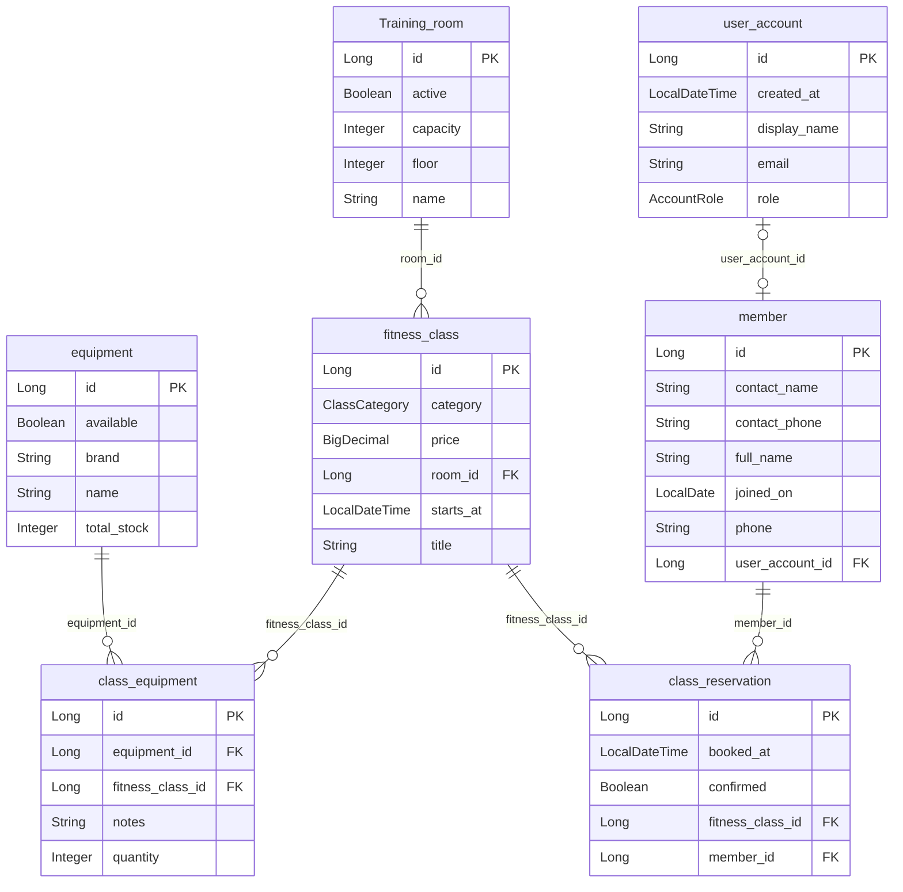

# Schemat bazy danych

Plik generują reguły projektu (panel Maven → Lifecycle → verify). Nie edytujcie go ręcznie.

Tabele: 7 · kolumny: 38 · relacje: 5 × @ManyToOne, 1 × @OneToMany, 1 × @OneToOne, 0 × @ManyToMany

| Tabela | Encja | Kolumny | Klucze obce |
|---|---|---|---|
| Training_room | TrainingRoom | 5 | — |
| class_equipment | ClassEquipment | 5 | equipment_id, fitness_class_id |
| class_reservation | ClassReservation | 5 | fitness_class_id, member_id |
| equipment | Equipment | 5 | — |
| fitness_class | FitnessClass | 6 | room_id |
| member | Member | 7 | user_account_id |
| user_account | UserAccount | 5 | — |

